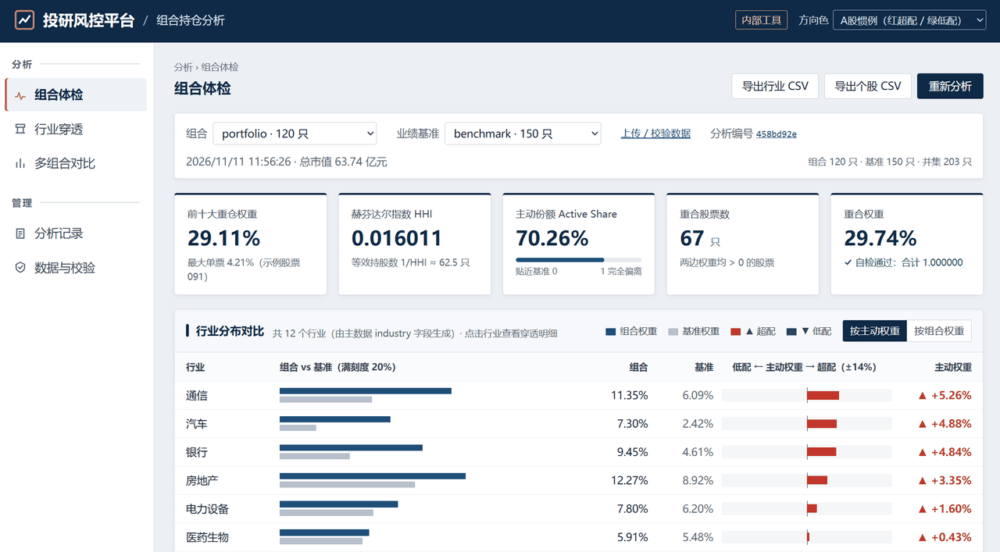
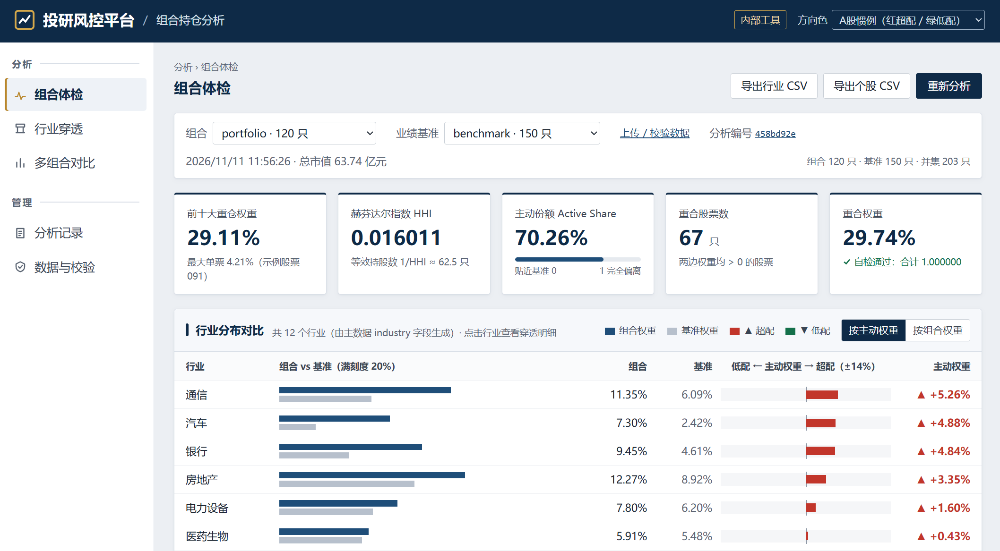
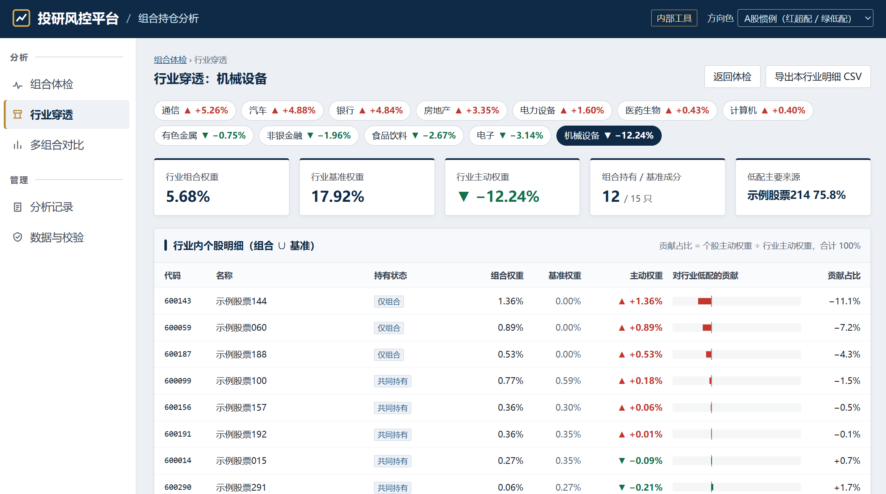
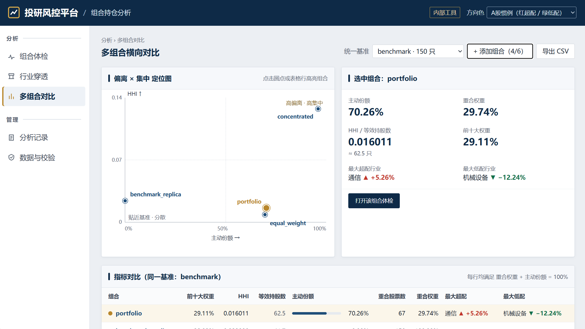
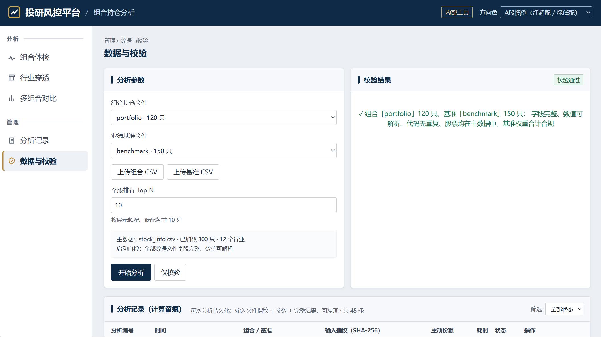
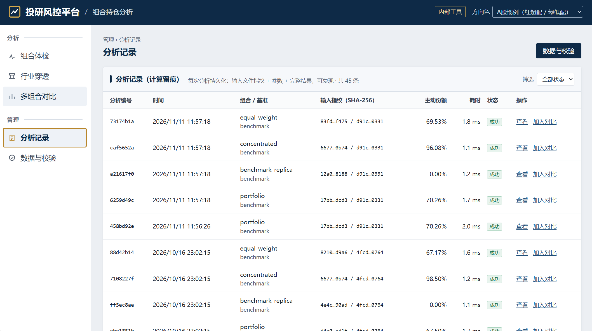

# 投资组合持仓分析工具 · Portfolio Holdings Analyzer

   

**给股票组合做一次“体检”**：它重仓了哪些行业？和基准相比哪里买多了、哪里买少了？是否过度集中？整体和基准有多像？
上传持仓和基准，几秒钟得到行业分布、超低配、集中度、主动份额与重合度，并能一路追到是哪几只股票造成了偏离。

> **English** — A full-stack tool that runs a "health check" on an equity portfolio against a benchmark index:
> industry allocation and over/underweights, concentration (top-10, HHI), per-stock active weights, active share
> and overlap — with one-click industry drill-down, side-by-side comparison of multiple portfolios, data validation
> with line-level error reports, and a full audit trail. All sample data is synthetic.



---

## 功能一览

### 📋 组合体检 —— 一屏看清组合和基准差在哪

- **指标卡**：前十大权重、HHI（附“等效持股数 = 1/HHI”）、主动份额、重合股票数、重合权重，均显示 6 位精确值，并自检“重合权重 + 主动份额 = 1”。
- **行业分布表**：每个行业一行，组合 / 基准权重双条并列，旁边是**以零线居中的主动权重发散条**——超配向右、低配向左，配合 `▲ +x.xx%` / `▼ −x.xx%`，哪个行业偏得最多、往哪边偏一眼可见。可按主动权重或组合权重排序。
- **超配 / 低配 Top N**：两张排行并排，可切换 5 / 10 / 20；低配表单独标出“仅基准”的股票，也就是组合没买的权重股。
- **持仓明细**：全部持仓的市值、组合权重、基准权重、主动权重；支持搜索、按行业筛选、表头排序、分页，并可切换为包含未持有基准成分的并集视图。
- 顶部可随时切换组合 / 基准，重新分析。



### 🔍 行业穿透 —— 从“偏离了”到“谁造成的”

点击任一行业，进入独立的穿透页（链接可直接分享）：

- 行业胶囊按 |主动权重| 排序，一键切换行业；
- 概览卡：该行业的组合 / 基准 / 主动权重、组合持有与基准成分只数、**超配（低配）的主要来源**；
- 个股明细覆盖该行业“组合 ∪ 基准”的全部股票，标注“共同持有 / 仅组合 / 仅基准”，并给出**贡献占比 = 个股主动权重 ÷ 行业主动权重**（合计 100%）和贡献条。比如低配 3.9%，是因为漏掉了哪几只权重股，还是持仓普遍偏小，一看便知。



### ⚖️ 多组合对比 —— 同一基准下横向比较

勾选 2~6 个组合、指定统一基准：

- **偏离 × 集中定位图**：横轴主动份额、纵轴 HHI，四象限中谁“高偏离 · 高集中”一目了然；
- 选中组合的摘要（主动份额、重合权重、HHI、前十大、最大超配 / 低配行业），可一键跳转到它的体检页；
- 指标对比表、行业主动权重对照表，可导出 CSV。

适合风控横评多只产品，或投研比较调仓前后：先上传调仓后的模拟持仓，再和当前持仓并排看。



### ✅ 数据与校验 —— 错在哪一行、哪只股票、哪个字段

- 上传组合 / 基准 CSV（或通过 API 提交 JSON），支持 UTF-8、UTF-8 BOM、GBK，股票代码保留前导 0；
- **仅校验**模式：同时检查组合与基准，问题按规则翻译成业务语言并给出处理建议，精确到行号、代码和字段，原始错误 JSON 可展开查看；
- 能识别的问题包括：市值为零或为负、代码重复、股票不在主数据、基准权重为负或合计偏离 1、缺列、数值无法解析（含 NaN / Inf）、空文件、未加引号的千分位数字导致列数错位等；
- 损坏的预置数据源只会被标为“不可用”并说明原因，不影响其他数据源。分析被拒时，体检页提供“查看校验详情”，带着所选数据跳到校验页。



### 🗂️ 分析记录 —— 每次分析都可追溯

- 每次分析（包括失败的）都会留痕：组合 / 基准 / 主数据三个文件的 **SHA-256 指纹**、时间、耗时、参数、完整结果或失败原因；
- 记录页可按状态筛选、回看结果或错误、一键加入对比；上传的数据重启后仍在。



### 其他细节

- 行业分布、个股主动权重一键导出 CSV，Excel 直接打开不乱码；
- 配色默认按 A 股习惯“红超配 / 绿低配”，可切换为色弱友好的“橙 / 蓝”，全站同步并记住选择；方向始终同时用 ▲/▼ 和 +/− 表示，不只靠颜色；
- 前端不依赖任何 CDN 或图表库，可在内网离线使用。

---

## 指标速查

| 指标 | 含义 |
|---|---|
| 组合权重 | 个股市值 ÷ 组合总市值 |
| 行业权重 / 主动权重 | 按行业汇总的组合、基准权重及其差值；行业清单完全来自数据 |
| 前十大权重 | 权重最高的 10 只股票之和（并列按代码升序） |
| HHI | Σ w²，越大越集中；1/HHI 为等效持股数 |
| 个股主动权重 | 组合权重 − 基准权重（在组合 ∪ 基准上计算） |
| 主动份额 | 0.5 × Σ\|组合权重 − 基准权重\|，0 = 与基准相同，1 = 完全不同 |
| 重合度 | 重合股票数（两边都持有）与重合权重 Σ min(组合, 基准) |

完整口径、排序与舍入规则、校验规则见 **[docs/METHODOLOGY.md](docs/METHODOLOGY.md)**。

---

## 快速开始

需要 Python 3.11+、Node 20+。

```bash
# 后端依赖
cd backend
python3 -m venv .venv
.venv/bin/pip install -r requirements.txt          # Windows: .venv\Scripts\pip

# 前端构建
cd ../frontend
npm install && npm run build                         # 产物 frontend/dist 由后端直接托管

# 启动（前后端同端口）
cd ../backend
.venv/bin/python -m app --port 8000
```

打开 http://127.0.0.1:8000 即可使用，API 文档在 http://127.0.0.1:8000/docs。
前端开发模式：后端启动后在 `frontend/` 运行 `npm run dev`，打开 http://localhost:5173（`/api` 自动代理）。

**内置示例数据**（均为虚构）：300 只“示例股票”、12 个行业，1 个默认基准和 7 个特征鲜明的组合——默认组合、指数增强、高集中度、行业主题、等权分散、前十大并列、复制基准。`samples/invalid/` 下有 6 个非法文件，可用于体验上传校验。

**用自己的数据**：替换 `data/` 下的文件后重启，或直接在界面上传。

| 文件 | 字段 |
|---|---|
| `data/stock_info.csv` | `stock_code, stock_name, industry` |
| `data/portfolios/<id>.csv` | `stock_code, market_value` |
| `data/benchmarks/<id>.csv` | `stock_code, weight`（`benchmark.csv` 为默认基准） |

| 环境变量 | 默认值 | 说明 |
|---|---|---|
| `PA_DATA_DIR` | `data` | 数据目录 |
| `PA_DB_PATH` | `backend/var/history.db` | 留痕数据库 |
| `PA_FRONTEND_DIST` | `frontend/dist` | 前端产物目录（不存在则只提供 API） |
| `PA_MAX_UPLOAD_MB` | `20` | 单个上传文件大小上限 |
| `PA_MAX_RUNS` | `0`（不限） | 只保留最近 N 条分析记录 |
| `PA_MAX_UPLOADS` | `0`（不限） | 上传数据源数量上限 |

### Docker / 部署

```bash
docker build -t portfolio-analyzer .
docker run -p 8000:8000 portfolio-analyzer        # 打开 http://127.0.0.1:8000
```

仓库自带 `render.yaml`，可在 [Render](https://render.com) 上通过 **New → Blueprint** 选择本仓库一键部署（免费实例，闲置后休眠，再次访问需等待约 30–60 秒唤醒；实例重启后上传数据与分析记录会清空）。公开实例默认启用上面三项限制：上传 2MB、记录 200 条、上传 20 个。

---

## HTTP API

所有功能都可以通过 API 调用。出错时统一返回 `{"error": {"code", "message", "details"}}`，任何情况下都不返回堆栈。

| 方法 & 路径 | 说明 |
|---|---|
| `GET /api/portfolios`、`GET /api/benchmarks` | 数据源列表（可用状态、不可用原因、行数、SHA-256） |
| `POST /api/portfolios` | 以 JSON 提交持仓 |
| `POST /api/portfolios/upload`、`POST /api/benchmarks/upload` | 上传 CSV |
| `POST /api/validations` | 仅校验，不留痕 |
| `POST /api/analyses` | 执行分析并留痕（`portfolio_id`、`benchmark_id?`、`top_n?`） |
| `GET /api/analyses/{id}` | 取回某次分析的完整结果 |
| `GET /api/analyses/{id}/industries` | 行业分布 |
| `GET /api/analyses/{id}/active-weights?side=over\|under\|all&top=N&industry=` | 超配 / 低配排行 |
| `GET /api/analyses/{id}/export?type=industry\|active` | 导出 CSV |
| `POST /api/comparisons` | 多组合对比同一基准 |
| `GET /api/history` | 分析记录（可按组合、状态筛选） |
| `GET /api/meta` | 主数据规模、行业清单、默认基准 |

```bash
curl -s -X POST localhost:8000/api/analyses -H 'Content-Type: application/json' \
     -d '{"portfolio_id":"portfolio","benchmark_id":"benchmark"}'
curl -s 'localhost:8000/api/analyses/<id>/active-weights?side=under&top=5'
```

数据不合规返回 422，错误码与 [校验规则](docs/METHODOLOGY.md#5-校验规则) 一一对应；资源不存在返回 404，参数非法返回 400，文件超过 20MB 返回 413。

---

## 架构

```
backend/app/
  loaders/   CSV 解析与校验（只管 I/O）
  engine/    analyzer.py 纯计算的分析引擎；rounding.py 仅在输出时舍入
  repo/      数据源注册表、SQLite 留痕
  service.py 加载 → 校验 → 分析 → 留痕
  api/       FastAPI 路由与统一错误处理
frontend/src/
  pages/     组合体检、行业穿透、多组合对比、分析记录
  components/ 行业表、个股表、持仓明细、上传与校验面板等
ui-spec/     界面规格与设计令牌
docs/        计算口径
```

- **后端**：FastAPI + SQLite（标准库）。引擎为纯 Python，不依赖 pandas / numpy，输入是领域对象，与文件 I/O 完全解耦。
- **前端**：React 19 + TypeScript + Vite，条形图和散点图用 CSS 绘制。

## 质量与性能

- **准确**：中间计算不舍入（`math.fsum`），输出时以 `Decimal` 四舍五入到 6 位。测试中的参考答案由一份基于 `fractions.Fraction` 的**独立精确实现**生成，与引擎互不依赖。
- **测试**：107 个用例，覆盖口径、加载、API、容错与性能，其中包括 37 个边界场景（并列、舍入边界、仅基准持有、编码格式、各类非法数据等），每个场景都是一套可直接启动查看的数据目录：
  ```bash
  cd backend && .venv/bin/python -m pytest
  ```
- **性能**：组合与基准各 5,000 只股票时，引擎完成全部指标约 55 ms，端到端 API（含校验和落库）约 96 ms（Ryzen 7 4800H）。复现方法：
  ```bash
  cd backend
  .venv/bin/python scripts/gen_stress.py && .venv/bin/python scripts/benchmark_perf.py
  ```

数据生成脚本都在 `backend/scripts/`：`gen_sample.py`（默认数据和参考答案）、`gen_portfolios.py`（演示组合）、`gen_boundary_cases.py`（边界场景）、`gen_stress.py`（压测数据），均使用固定种子，结果可复现。

---

## License

[MIT](LICENSE)
